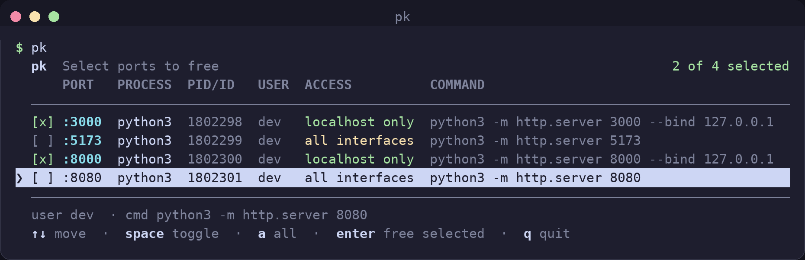
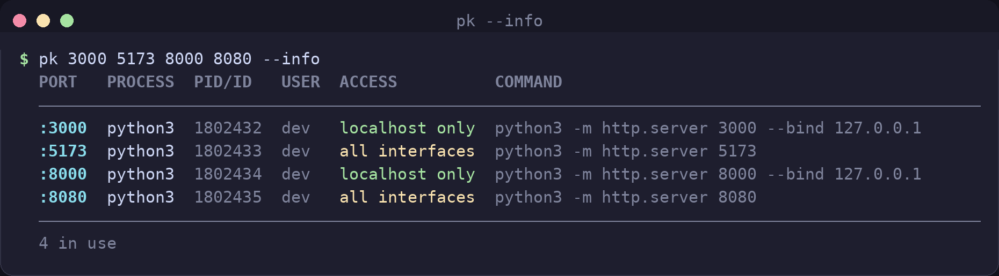
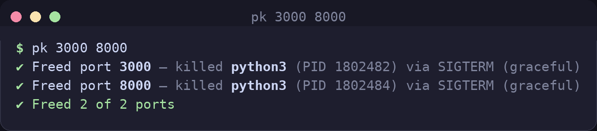

<p align="center">
  
</p>

# port-kill-cli (`pk` / `kp` / `kill-port`)

[](https://www.npmjs.com/package/@majidev-org/port-kill-cli)
[](https://github.com/majidev-org/port-kill-cli/actions/workflows/publish.yml)
[](https://nodejs.org)
[](LICENSE)

A fast, zero-dependency, cross-platform CLI to find and kill processes occupying ports on **Linux**, **macOS**, and **Windows**.

Stop Googling `lsof` vs `netstat`—just run `pk 3000` (`kp`, `kill-port` and `port-kill` are the same command).

<p align="center">
  
</p>

[npm package](https://www.npmjs.com/package/@majidev-org/port-kill-cli) · [Source](https://github.com/majidev-org/port-kill-cli) · [Report an issue](https://github.com/majidev-org/port-kill-cli/issues) · [Security policy](SECURITY.md) · [Privacy](PRIVACY.md) · [Terms](TERMS.md)

## Features
- **Zero Dependencies:** Instant startup with `npx`—no bloated `node_modules` tree.
- **Cross-Platform:** Works seamlessly on Linux (`ss`, falling back to `lsof`), macOS (`lsof`), and Windows (`netstat` / `taskkill`).
- **Safe & Graceful:** On Linux/macOS sends `SIGTERM` first so servers clean up properly, escalating to `SIGKILL` only if needed. Before every signal it re-checks that the PID still holds the port, so a recycled PID is never killed by mistake. Everything running under the port holder is stopped with it (as `taskkill /T` does on Windows), and `--tree` also stops its parent. Windows has no graceful signal for server processes, so `taskkill /T /F` is always used there.
- **Process Info:** Shows the process name and PID, who can reach the port (`all interfaces` or `localhost only`), and on Linux/macOS the owning user and full command line. Docker containers show their image.
- **Clear Results:** Every freed port says how it was stopped (`SIGTERM (graceful)`, `SIGTERM, then SIGKILL`, `SIGKILL (forced)`, `taskkill /T /F`, `docker stop`) and multi-port runs end with a `Freed 3 of 4 ports` summary.
- **Multi-Port & Ranges:** Kill single ports, multiple ports, or port ranges in one command. Ports are freed concurrently, so five servers take about half a second, not five times as long. Large ranges print one summary line for the free ports instead of one line each.
- **Docker-Aware:** Ports published by a Docker container are freed with `docker stop` instead of killing Docker's proxy (which would break Docker networking). Remote Docker contexts (`DOCKER_HOST=tcp://…`, `ssh://…`) are ignored, so a container on another machine is never stopped because its port number matches.
- **Interactive Mode:** Run `pk` with no arguments to see every port in use and tick the ones to free.

## Requirements
- [Node.js](https://nodejs.org) 18 or newer.
- Linux: [`ss`](https://man7.org/linux/man-pages/man8/ss.8.html) (falls back to [`lsof`](https://man7.org/linux/man-pages/man8/lsof.8.html) when `ss` is missing). macOS: `lsof`. Both also use `ps` for the owner and command.
- Windows: `netstat`, `tasklist` and `taskkill`, which ship with the OS.
- Optional: [Docker](https://docs.docker.com/get-docker/) to detect and stop containers that publish ports.

## Installation & Quick Start

### Run without installing (`npx`)
```bash
npx @majidev-org/port-kill-cli 3000
```

### Install globally for the shortcuts
```bash
npm install -g @majidev-org/port-kill-cli
pk 3000                   # or: kp 3000 (also available as `port-kill` and `kill-port`)
```

### Update

npm does not notify you about new versions of a global package, so check from time to time:

```bash
pk --version                                    # what you have
npm view @majidev-org/port-kill-cli version     # latest published
npm outdated -g @majidev-org/port-kill-cli      # shows current vs latest (no output = up to date)

npm install -g @majidev-org/port-kill-cli@latest   # update
```

With `npx`, add `@latest` (`npx @majidev-org/port-kill-cli@latest 3000`) to be sure you are not running a cached older copy. To hear about releases, use **Watch → Custom → Releases** on the [GitHub repository](https://github.com/majidev-org/port-kill-cli).

### Uninstall

```bash
npm uninstall -g @majidev-org/port-kill-cli
```

This removes all four commands (`pk`, `kp`, `kill-port`, `port-kill`). Use the package name, not a command name. `pk` stores no config or data, so nothing else is left behind. If you only ever used `npx`, nothing is installed; `npm cache clean --force` clears the cached download.

## Usage & Examples

```bash
# Kill a single port
pk 3000                   # or: kp 3000

# Kill multiple ports at once
pk 3000 5173 8080         # or: kp 3000 5173 8080

# Kill a range of ports
pk 3000-3005              # or: kp 3000-3005

# Inspect what is running on a port without killing it
pk 3000 --info            # or: kp 3000 --info

# Force kill immediately (skips graceful SIGTERM)
pk 3000 --force           # or: kp 3000 --force

# Also stop the parent that started it, e.g. a helper's app (Linux/macOS)
pk 3000 --tree            # or: kp 3000 --tree

# Pick ports to free from an interactive list
pk                        # or: kp

# List every port in use (processes and Docker containers)
pk --info                 # or: kp --info

# Show the installed version
pk --version              # or: kp --version

# Show help menu
pk --help                 # or: kp --help
```

Every example works with any of the command names below.

## Commands

| Command | Notes |
| :--- | :--- |
| `pk` | Shortest alias |
| `kp` | Alias |
| `kill-port` | Alias. Clashes with the separate `kill-port` npm package if both are installed globally |
| `port-kill` | Full name, never collides with other tools |

## Arguments

| Argument | Example | Meaning |
| :--- | :--- | :--- |
| `<port>` | `pk 3000` | A single port, 1–65535 |
| `<start>-<end>` | `pk 3000-3005` | An inclusive range |
| several | `pk 3000 5173 3000-3005` | Any mix of ports and ranges. Duplicates are ignored |
| none | `pk` | Interactive picker (see below) |

## Output

Inspect what holds your ports without killing anything:

<p align="center">
  
</p>

Free several ports at once. Each result says how the process was stopped, and a summary closes the run:

<p align="center">
  
</p>

- The table fits your terminal: the command column shrinks (and is cut with `…`) to the available width, and colors follow `NO_COLOR` and are off when output is piped. **`ACCESS`** is green for `localhost only` and yellow for `all interfaces`. Containers show their id, `container` and their image.
- **`localhost only`** means the port is bound to `127.0.0.1` / `::1`. **`all interfaces`** (`0.0.0.0`, `::`, `*`) means other machines on the network can reach it. Any other bind address is printed as is.
- **`user` and `cmd`** come from `ps`, so they appear on Linux and macOS only. Windows shows the process name, PID and bind address. Commands longer than 100 characters are shortened.
- Command lines can contain secrets such as tokens passed as arguments. `ps` shows them to any local user already, but keep it in mind before pasting `pk --info` output into a bug report.
- The `Freed N of M ports` summary appears when more than one port was handled. A failure sets exit code `1`.

## Options

| Flag | Alias | Description |
| :--- | :--- | :--- |
| `--info` | `-i` | Show the process, bind address, owner and command using the port without killing it |
| `--force` | `-f` | Immediately force-kill the process (`SIGKILL` / `taskkill /F` / `docker kill`) |
| `--tree` | | Also stop the process's parent and everything under it, for when the port is held by a helper of a larger app. Linux/macOS only. Never stops `pk`'s own terminal, `init`, a shell or a session manager. Docker containers are unaffected |
| `--version` | `-v` | Print the installed version |
| `--help` | `-h` | Display usage instructions and options |

Flags can go before or after the ports and can be combined: `pk 3000 -i`, `pk -f 3000-3005`.

By default `pk` stops the process that holds the port and everything running under it, not the app that started it. Many apps hold their port in a helper (VS Code's extension host, pgAdmin's server), so the window or app can stay open after its port is freed. `--tree` stops the parent as well, which can close the whole app and lose unsaved work, so check with `--info` first. An unknown flag or an invalid port (`abc`, `99999`, `3005-3000`) prints an error and exits with code `1`.

## Interactive Mode

Running `pk` with no ports lists every port in use as a checkbox list, so you tick exactly the ones to free:

```text
  pk  Select ports to free                                   2 of 3 selected
      PORT   PROCESS  PID/ID        USER       ACCESS          COMMAND
  ─────────────────────────────────────────────────────────────────────────
❯ [x] :3000  node     4121          alice      localhost only  node server.js
  [ ] :5173  node     4188          alice      localhost only  vite
  [x] :8080  api      a1b2c3d4e5f6  container  all interfaces  nginx:1.27
  ─────────────────────────────────────────────────────────────────────────
  user alice · cmd node server.js --port 3000
  ↑↓ move  ·  space toggle  ·  a all  ·  enter free selected  ·  q quit
```

The highlighted row is drawn as a selection bar, the line under the list shows the full owner and command of that row, and a `↑ n more` / `↓ n more` marker appears in the rule when the list is taller than your terminal.

| Key | Action |
| :--- | :--- |
| `↑` / `↓` (or `k` / `j`) | Move the cursor |
| `Space` | Tick or untick the port under the cursor |
| `a` | Tick all, or untick all if everything is already ticked |
| `Enter` | Free the ticked ports (nothing ticked = cancel) |
| `q`, `Esc` or `Ctrl+C` | Cancel without killing anything |

Long lists scroll to fit your terminal. `--force` and `--tree` also apply here (`pk -f`, `pk --tree`). `pk --info` prints the same list without prompting. With no terminal attached (for example in a script or CI), `pk` prints the help instead of waiting for input.

**Typed prompt:** when raw keypresses are not available (for example output is piped, as in `pk | tee out.txt`), the list is numbered instead and you type your choice:

| Input | Frees |
| :--- | :--- |
| `1` | Entry 1 |
| `1 3` or `1,3` | Entries 1 and 3 |
| `2-4` | Entries 2 to 4 |
| `a` or `all` | Every listed entry |
| Enter (empty) | Nothing, cancels |

## Exit Codes & Environment

| | |
| :--- | :--- |
| Exit `0` | Success, including when a port was already free |
| Exit `1` | Bad arguments, no tool available to list ports, or a process or container could not be stopped (for example permission denied) |
| `NO_COLOR` | Set to any non-empty value to disable colored output |

## Using in `package.json` Scripts
Ensure your dev port is always free before starting your server:

```json
{
  "scripts": {
    "predev": "npx @majidev-org/port-kill-cli 3000",
    "dev": "next dev"
  }
}
```

## Security

`pk` runs every system tool without a shell, validates ports as integers in 1–65535, and strips control, bidi and zero-width characters from process names before printing them (a process can name itself anything, including terminal escape codes). If no tool can list ports it fails with an error instead of claiming a port is free. On Windows, commands are resolved from `System32` so a stray `netstat.exe` in the current folder is never run. Killing another user's process needs `sudo` or Administrator rights. See [SECURITY.md](SECURITY.md) for the full list and how to report a vulnerability.

## Contributing

Bug reports and ideas are welcome in the [issue tracker](https://github.com/majidev-org/port-kill-cli/issues). To work on the code, see [CONTRIBUTING.md](CONTRIBUTING.md) and [TESTING.md](TESTING.md).

## Terms, Privacy & License

`pk` terminates processes, so read the [Terms of Use](TERMS.md) before using it on systems you don't own. It collects no data; see the [Privacy Policy](PRIVACY.md). Vulnerabilities go through the [Security Policy](SECURITY.md).

## License
[MIT](LICENSE) © [Majid Ali](https://majidev.netlify.app)
