<p align="center">
  
</p>

# cross-port-kill (`pk` / `cpk` / `kill-port`)

[](https://www.npmjs.com/package/cross-port-kill)
[](https://github.com/majidev-org/port-kill-cli/actions/workflows/publish.yml)
[](https://nodejs.org)
[](LICENSE)

Free a port without breaking Docker or killing the wrong process. `pk 3000` works the same on **Linux**, **macOS** and **Windows** and so do [seven other names](#commands) for the same command, such as `cpk` and `kill-port`.

- **Docker-aware:** a port published by a container is freed with `docker stop`, not by killing Docker's proxy and breaking its networking.
- **Graceful and safe:** `SIGTERM` first, `SIGKILL` only if the process won't exit, and the PID is re-checked before every signal so a recycled PID is never hit.
- **Interactive picker:** run `pk` alone to tick the ports to free from a list.
- **Type it your way:** `pk kill 3000`, `pk port 3000`, `pk what is on 3000`, `pk localhost:3000` or a pasted URL all work, and typos get a *did you mean*.
- **TCP and UDP:** TCP by default, UDP with `--udp`, `5353/udp` or `pk-udp`.
- **Zero dependencies:** nothing to download beyond the package itself, so `npx` starts instantly.

<p align="center">
  
</p>

**[Usage guide](USAGE.md)**: every command with an animation · [npm package](https://www.npmjs.com/package/cross-port-kill) · [Source](https://github.com/majidev-org/port-kill-cli) · [Report an issue](https://github.com/majidev-org/port-kill-cli/issues) · [Security policy](SECURITY.md) · [Privacy](PRIVACY.md) · [Terms](TERMS.md)

## Quick Start

Run it once without installing:

```bash
npx cross-port-kill 3000
```

Or install it for the short commands:

```bash
npm install -g cross-port-kill

pk 3000                   # the shortest name
cpk 3000                  # same thing
kill-port 3000            # same thing, if that's the name you remember
```

Needs [Node.js](https://nodejs.org) 18 or newer. Everything else ships with your OS (see [Requirements](#requirements)).

## Usage & Examples

The animations below show what each command prints. Every example works with any of the [command names](#commands). For everything in one place, with a cheat sheet, see the **[usage guide](USAGE.md)**.

### Free ports

<p align="center">
  
</p>

```bash
pk 3000                   # one port
pk 3000 5173 8080         # several at once (freed in parallel)
pk 3000-3005              # a range; free ports in it are just reported
```

### Just say it

Type what you mean in plain words. Questions only ever look, they never kill.

<p align="center">
  
</p>

```bash
pk kill 3000              # frees it (also: free, stop, close)
pk port 3000              # shows what holds it and the command to free it (also: show, check, list)
pk what is on 3000        # a question: shows, never kills (also: who uses 3000, is 3000 free)
pk kill -9 3000           # forced (also: pk force 3000)
pk kill the port on 3000  # filler words like the, on, at, using are fine
```

A mistyped word gets a suggestion: `pk kil 3000` answers *Did you mean "kill"?*.

### Write it however you remember

`pk` accepts a port the way you saw it, so you can paste straight from an error message, a browser or another tool:

<p align="center">
  
</p>

```bash
pk :3000                  # as shown by pk --info or fkill
pk localhost:3000         # any host:port; [::1]:3000 and :::3000 (EADDRINUSE) work too
pk http://localhost:5173/ # a URL from your browser or dev server
pk 3000,5173              # a comma list
pk 3000..3005             # another range style
pk udp:5353               # the protocol before or after: 5353/udp, udp/5353, 5353:udp
pk -ui 5353               # short flags combine
kill-port --port 3000 --method udp   # kill-port's own syntax
```

The host part is ignored: `pk` frees the port whatever address it's bound to. A mistyped option gets a suggestion (`--forse` → *Did you mean "--force"?*).

### See what's using a port, without killing it

<p align="center">
  
</p>

```bash
pk 3000 --info            # what holds port 3000
pk --info                 # every port in use, processes and Docker containers
```

### Docker containers

A port published by a container is freed by stopping the container, not by killing Docker's proxy process (which would break Docker networking).

<p align="center">
  
</p>

```bash
pk 8080                   # docker stop
pk 8080 --force           # docker kill
```

### Processes that won't stop

`pk` sends `SIGTERM` first so the server can shut down cleanly. If it's still holding the port after 300 ms, `pk` follows up with `SIGKILL`. `--force` skips straight to it.

<p align="center">
  
</p>

```bash
pk 9000                   # SIGTERM, then SIGKILL only if needed
pk 9000 --force           # SIGKILL immediately
```

### Child processes and whole apps

By default only the process holding the port is stopped, not what runs under it and not the app that started it. Many apps hold their port in a helper (VS Code's extension host, pgAdmin's server), so the app can stay open after its port is freed. `--children` also stops what runs under the holder, such as workers behind a server. `--tree` stops its parent too, which can close the whole app and lose unsaved work, so it lists the parents and asks first. Both are Linux/macOS only.

<p align="center">
  
</p>

```bash
pk 3000 --children        # the holder and everything under it
pk 5050 --tree            # its parent too, after asking [y/N]
pk 5050 --tree --yes      # same, without the question (scripts)
```

### UDP ports

Ports are TCP unless you ask for UDP, so a plain port number never stops a UDP socket by accident.

<p align="center">
  
</p>

```bash
pk udp ports              # list UDP ports in use, with commands to free them (also: pk udp)
pk tcp udp ports          # list both (also: pk both)
pk 5353 --udp             # UDP port 5353
pk 5353/udp               # the same, as a suffix
pk-udp 5353               # the same, as its own command
pk 5353/udp 3000          # UDP 5353 and TCP 3000 in one go
pk 53 --tcp --udp         # both protocols
pk --udp --info           # every UDP port in use (or: pk-udp --info)
pk --udp                  # pick UDP ports from the interactive list (or: pk-udp)
```

### Pick from a list

```bash
pk                        # tick ports to free, see Interactive Mode below
```

## Interactive Mode

Running `pk` with no ports lists every port in use as a checkbox list, so you tick exactly the ones to free:

```text
  pk  Select ports to free                                   2 of 3 selected
      PORT   PROCESS  PID/ID        USER       ACCESS          COMMAND
  ─────────────────────────────────────────────────────────────────────────
❯ [x] :3000  node     4121          alice      localhost only  node server.js
  [ ] :5173  node     4188          alice      localhost only  vite
  [x] :8080  api      a1b2c3d4e5f6  container  all interfaces  nginx:1.27
  ─────────────────────────────────────────────────────────────────────────
  [ ] Also stop what it started  --children
  [ ] Also close the app that started it  --tree
  user alice · cmd node server.js --port 3000
  ↑↓ move  ·  space toggle  ·  a all  ·  c children  ·  t app  ·  enter free selected  ·  q quit
```

| Key | Action |
| :--- | :--- |
| `↑` / `↓` (or `k` / `j`) | Move the cursor |
| `Space` | Tick or untick the port under the cursor |
| `a` | Tick all, or untick all if everything is already ticked |
| `c` | Tick or untick **Also stop what it started** (same as `--children`) |
| `t` | Tick or untick **Also close the app that started it** (same as `--tree`) |
| `Enter` | Free the ticked ports (nothing ticked = cancel) |
| `q`, `Esc` or `Ctrl+C` | Cancel without killing anything |

The two options under the list work like the ports: move onto one with `↑`/`↓` and press `Space`, or press its key from anywhere. Ticking the app also shows the children as included. Closing the app still lists the parents and asks `[y/N]` first, and the flags `--children` / `--tree` just start with the boxes ticked. The options are hidden on Windows, where children are always stopped and `--tree` is not supported.

The highlighted row is drawn as a selection bar, the line under the list shows the full owner and command of that row, and a `↑ n more` / `↓ n more` marker appears in the rule when the list is taller than your terminal.

Long lists scroll to fit your terminal. `--force`, `--children` and `--tree` also apply here (`pk -f`, `pk --tree`), and `--udp` lists UDP ports instead (`pk --udp`). `pk --info` prints the same list without prompting. With no terminal attached (for example in a script or CI), `pk` prints the help instead of waiting for input.

**Typed prompt:** when raw keypresses are not available (for example output is piped, as in `pk | tee out.txt`), the list is numbered instead and you type your choice. It has no checkboxes, so use the flags for children or the app.

| Input | Frees |
| :--- | :--- |
| `1` | Entry 1 |
| `1 3` or `1,3` | Entries 1 and 3 |
| `2-4` | Entries 2 to 4 |
| `a` or `all` | Every listed entry |
| Enter (empty) | Nothing, cancels |

## Options

| Flag | Alias | Description |
| :--- | :--- | :--- |
| `--info` | `-i` | Show the process, bind address, owner and command using the port without killing it |
| `--force` | `-f` | Immediately force-kill the process (`SIGKILL` / `taskkill /F` / `docker kill`) |
| `--children` | `-c` | Also stop everything running under the process, such as workers behind a server. Linux/macOS only, because `taskkill /T` already does this on Windows |
| `--tree` | | Stop the process's parent and everything under that (which includes `--children`), for when the port is held by a helper of a larger app. Linux/macOS only. Never stops `pk`'s own terminal, `init`, a shell or a session manager. Docker containers are unaffected. It lists the parents it would stop and asks `[y/N]` first (without a terminal it refuses unless you pass `--yes`) |
| `--yes` | `-y` | Skip the `--tree` question |
| `--udp` | `-u` | Use UDP ports instead of TCP. Also what `pk` and `pk --info` list. The `pk-udp` command has it built in |
| `--tcp` | `-t` | Use TCP ports (the default). With `--udp`, check both |
| `--port <ports>` | `-p` | Ports given as an option, as `kill-port` does: `-p 3000`, `--port=3000,3001` |
| `--method <tcp\|udp>` | `-m` | The protocol, as `kill-port` does: `--method udp`. Same as `--udp` |
| `--version` | `-v` | Print the installed version |
| `--help` | `-h` | Display usage instructions and options |

Flags can go before or after the ports, are not case-sensitive, and short ones can be combined: `pk 3000 -i`, `pk -f 3000-3005`, `pk -ui 5353`, `pk --UDP 5353`, `pk -udp 5353`.

## Arguments

| Argument | Examples | Meaning |
| :--- | :--- | :--- |
| port | `3000`, `:3000` | A single port, 1–65535 |
| host and port | `localhost:3000`, `127.0.0.1:3000`, `[::1]:3000`, `:::3000`, `*:3000` | The port; the host is ignored |
| URL | `http://localhost:5173/app` | Its port, or 80 / 443 when the URL has none |
| range | `3000-3005`, `3000..3005`, `3000–3005` | An inclusive range |
| list | `3000,5173,8080` | Same as separate arguments |
| with a protocol | `5353/udp`, `5353:udp`, `udp/5353`, `udp:5353`, `4000-4005/udp` | That port over UDP (or TCP), whatever the flags say |
| several | `pk 3000 5173 3000-3005 5353/udp` | Any mix of the above. Duplicates are ignored |
| none | `pk` | [Interactive picker](#interactive-mode) |

Words work too, anywhere in the command:

| Words | Mean |
| :--- | :--- |
| `kill`, `free`, `stop`, `close`, `end`, `release`, `terminate` | Free the ports (the default anyway) |
| `port`, `ports`, `show`, `check`, `find`, `status`, `inspect`, `list`, `ls`, `info` | `--info`, unless a kill word is also there (`pk kill port 3000` frees it) |
| `what`, `who`, `which`, `is` | A question: always `--info`, even with a kill word (`pk is 3000 free` never kills) |
| `force`, `-9` | `--force` |
| `tcp`, `udp`, `both` | The protocol. On their own they list those ports: `pk udp`, `pk tcp udp ports`, `pk both` |
| `children`, `tree`, `help`, `version` | The option of the same name |
| `on`, `at`, `the`, `and`, `all`, `only`, `open`, `using`, `uses`, `by`, `in`, `of`, `for`, `my`, `please`, … | Ignored |

An explicit flag always wins: `pk kill 3000 --info` only looks.

## Commands

Installing the package adds ten commands. The first eight are the same program, so pick the one you remember or type fastest.

| Command | Example | Why it's there |
| :--- | :--- | :--- |
| `pk` | `pk 3000` | Shortest: **p**ort **k**ill |
| `kp` | `kp 3000` | Same letters reversed: **k**ill **p**ort |
| `cpk` | `cpk 3000` | **C**ross **p**ort **k**ill, the package name shortened |
| `ckp` | `ckp 3000` | **C**ross **k**ill **p**ort |
| `port-kill` | `port-kill 3000` | Spelled out |
| `kill-port` | `kill-port 3000` | Spelled out the other way round |
| `cross-port-kill` | `cross-port-kill 3000` | Matches the package name, so it's the same in `npx` and after installing |
| `cross-kill-port` | `cross-kill-port 3000` | Package name the other way round |

Two more commands start with a protocol chosen, for when you work with UDP often:

| Command | Example | Same as |
| :--- | :--- | :--- |
| `pk-udp` | `pk-udp 5353` | `pk 5353 --udp` |
| `pk-tcp` | `pk-tcp 3000` | `pk 3000 --tcp`, which is also plain `pk 3000` |

Every option works with them (`pk-udp --info`, `pk-udp` alone opens the picker with UDP ports). A suffix still wins (`pk-udp 3000/tcp` is TCP), and adding the other flag checks both (`pk-udp 53 --tcp`).

If another globally installed tool also provides `pk`, `port-kill` or `kill-port`, whichever was installed last takes that name. `cross-port-kill` and `cross-kill-port` are unlikely to be taken by anything else, so use them in scripts and shared docs.

## Using in `package.json` Scripts

Make sure your dev port is free before your server starts:

```json
{
  "scripts": {
    "predev": "npx cross-port-kill 3000",
    "dev": "next dev"
  }
}
```

For a team project, add it as a dev dependency so everyone gets the same version and the script needs no download:

```bash
npm install --save-dev cross-port-kill
```

```json
{
  "scripts": {
    "predev": "cross-port-kill 3000 5173",
    "dev": "next dev",
    "ports": "cross-port-kill --info"
  }
}
```

Use `cross-port-kill` (not `pk`) in scripts: it is the name least likely to clash with another tool on a teammate's machine.

## Reading the Output

- Every freed port says how it was stopped: `SIGTERM (graceful)`, `SIGTERM, then SIGKILL`, `SIGKILL (forced)`, `taskkill /T /F` or `docker stop`. When more than one port was handled, a `Freed N of M ports` summary closes the run.
- The table fits your terminal: the command column shrinks (and is cut with `…`) to the available width, and colors follow `NO_COLOR` and are off when output is piped. Containers show their id, `container` and their image.
- **`ACCESS`** is green for `localhost only` (bound to `127.0.0.1` / `::1`) and yellow for `all interfaces` (`0.0.0.0`, `::`, `*`), which means other machines on the network can reach the port. Any other bind address is printed as is.
- UDP ports show as `:5353/udp` in the table and in results. TCP ports have no suffix.
- `--info` ends with the command that frees what it showed (`To free it: pk 3000`), using the command name you typed.
- **`user` and `cmd`** come from `ps`, so they appear on Linux and macOS only. Windows shows the process name, PID and bind address. Commands longer than 100 characters are shortened.
- Command lines can contain secrets such as tokens passed as arguments. `ps` shows them to any local user already, but keep it in mind before pasting `pk --info` output into a bug report.

## How It Works

- **Finding ports:** Linux uses `ss` (falling back to `lsof`), macOS uses `lsof`, and Windows uses `netstat`, each in a single call. A TCP port counts when something listens on it; a UDP port when a socket is bound to it. Connected UDP client sockets (a DNS lookup, a QUIC connection) are ignored.
- **Stopping processes:** on Linux/macOS, `SIGTERM` first and `SIGKILL` only if the process is still there after 300 ms. Before every signal `pk` re-checks that the PID still holds the port, so a recycled PID is never killed by mistake. Windows has no graceful signal for server processes, so `taskkill /T /F` (the holder and everything under it) is always used there.
- **Docker:** ports published by a running container are matched to that container (by port and protocol) and freed with `docker stop`, never by killing Docker's proxy. Remote Docker contexts (`DOCKER_HOST=tcp://…`, `ssh://…`) are ignored, so a container on another machine is never stopped because its port number matches.
- **Speed:** ports are freed concurrently, so five servers take about half a second, not five times as long. Large ranges print one summary line for the free ports instead of one line each.

## Requirements

- [Node.js](https://nodejs.org) 18 or newer.
- Linux: [`ss`](https://man7.org/linux/man-pages/man8/ss.8.html) (falls back to [`lsof`](https://man7.org/linux/man-pages/man8/lsof.8.html) when `ss` is missing). macOS: `lsof`. Both also use `ps` for the owner and command.
- Windows: `netstat`, `tasklist` and `taskkill`, which ship with the OS.
- Optional: [Docker](https://docs.docker.com/get-docker/) to detect and stop containers that publish ports.

## Exit Codes & Environment

| | |
| :--- | :--- |
| Exit `0` | Success, including when a port was already free |
| Exit `1` | Bad arguments, no tool available to list ports, or a process or container could not be stopped (for example permission denied) |
| `NO_COLOR` | Set to any non-empty value to disable colored output |

## Security

`pk` runs every system tool without a shell, validates ports as integers in 1–65535, and strips control, bidi and zero-width characters from process names before printing them (a process can name itself anything, including terminal escape codes). If no tool can list ports it fails with an error instead of claiming a port is free. On Windows, commands are resolved from `System32` so a stray `netstat.exe` in the current folder is never run. Killing another user's process needs `sudo` or Administrator rights. See [SECURITY.md](SECURITY.md) for the full list and how to report a vulnerability.

## Update

npm does not notify you about new versions of a global package, so check from time to time:

```bash
pk --version                                    # what you have
npm view cross-port-kill version                # latest published
npm outdated -g cross-port-kill                 # shows current vs latest (no output = up to date)

npm install -g cross-port-kill@latest           # update
```

With `npx`, add `@latest` (`npx cross-port-kill@latest 3000`) to be sure you are not running a cached older copy. To hear about releases, use **Watch → Custom → Releases** on the [GitHub repository](https://github.com/majidev-org/port-kill-cli).

## Uninstall

```bash
npm uninstall -g cross-port-kill
```

This removes all ten commands (`pk`, `kp`, `cpk`, `ckp`, `port-kill`, `kill-port`, `cross-port-kill`, `cross-kill-port`, `pk-udp`, `pk-tcp`). Use the package name, not a command name. `pk` stores no config or data, so nothing else is left behind. If you only ever used `npx`, nothing is installed; `npm cache clean --force` clears the cached download.

## Contributing

The full [usage guide](USAGE.md) covers every command. Bug reports and ideas are welcome in the [issue tracker](https://github.com/majidev-org/port-kill-cli/issues). To work on the code, see [CONTRIBUTING.md](CONTRIBUTING.md) and [TESTING.md](TESTING.md).

## License, Terms & Privacy

[MIT](LICENSE) © [Majid Ali](https://majidev.netlify.app)

`pk` terminates processes, so read the [Terms of Use](TERMS.md) before using it on systems you don't own. It collects no data; see the [Privacy Policy](PRIVACY.md). Vulnerabilities go through the [Security Policy](SECURITY.md).
