# cross-port-kill usage guide

Every way to use `pk`, with an animation for each. For installation and an overview, see the [README](README.md).

All examples use `pk`, but every [command name](#every-command-name) works the same: `cpk 3000`, `kill-port 3000` and `cross-port-kill 3000` are identical.

## Contents

- [Cheat sheet](#cheat-sheet)
- [Free ports](#free-ports)
- [Just say it](#just-say-it)
- [Write a port any way](#write-a-port-any-way)
- [Look before you kill](#look-before-you-kill)
- [TCP and UDP](#tcp-and-udp)
- [Pick from a list](#pick-from-a-list)
- [Docker containers](#docker-containers)
- [Processes that won't stop](#processes-that-wont-stop)
- [Child processes and whole apps](#child-processes-and-whole-apps)
- [Every command name](#every-command-name)
- [Scripts and CI](#scripts-and-ci)

## Cheat sheet

| I want to… | Type |
| :--- | :--- |
| Free port 3000 | `pk 3000` or `pk kill 3000` |
| Free several ports | `pk 3000 5173 8080` or `pk 3000,5173,8080` |
| Free a range | `pk 3000-3005` or `pk 3000..3005` |
| See what's on port 3000, without killing it | `pk port 3000` or `pk 3000 --info` or `pk what is on 3000` |
| See every port in use | `pk ports` or `pk --info` or `pk list` |
| See UDP ports in use | `pk udp` or `pk udp ports` |
| See TCP and UDP ports in use | `pk both` or `pk tcp udp ports` |
| Pick ports to free from a list | `pk` (TCP), `pk --udp` or `pk-udp` (UDP), `pk --tcp --udp` (both) |
| Free a UDP port | `pk 5353/udp` or `pk udp 5353` or `pk-udp 5353` |
| Free a port from an error message | `pk :::3000` or `pk 127.0.0.1:3000` (paste it as is) |
| Free the port in a URL | `pk http://localhost:5173/` |
| Free a port held by Docker | `pk 8080` (stops the container) |
| Kill right away, no grace period | `pk 3000 --force` or `pk kill -9 3000` or `pk force 3000` |
| Also stop the workers under it | `pk 3000 --children` |
| Close the whole app holding the port | `pk 3000 --tree` (asks first) |
| Do it in a script without questions | `cross-port-kill 3000 --tree --yes` |
| Check the version | `pk --version` or `pk version` |
| See all options | `pk --help` or `pk help` |

## Free ports

<p align="center">
  
</p>

```bash
pk 3000                   # one port
pk 3000 5173 8080         # several, freed in parallel
pk 3000-3005              # an inclusive range; ports in it that are free are just reported
pk 3000,5173 8000-8002    # any mix
```

Each line says how the process was stopped (`SIGTERM (graceful)`, `SIGTERM, then SIGKILL`, `SIGKILL (forced)`, `taskkill /T /F` or `docker stop`). With more than one port, a `Freed N of M ports` summary closes the run. A port that is already free is not an error.

## Just say it

Type what you mean. Words can go anywhere in the command, and a mistyped word gets a *did you mean*.

<p align="center">
  
</p>

```bash
pk kill 3000              # frees it
pk free 3000              # same (also: stop, close, end, release, terminate)
pk port 3000              # shows what holds it and the command to free it
pk show 3000              # same (also: check, find, status, inspect, list, ls, info)
pk what is on 3000        # a question: shows, never kills
pk who uses 3000          # same
pk is 3000 free?          # same, even with "free" in it
pk kill the port on 3000  # filler words are ignored
pk kill -9 3000           # forced
pk force 3000             # same
pk kil 3000               # ✖ Unknown word: "kil". Did you mean "kill"?
```

| Words | Mean |
| :--- | :--- |
| `kill`, `free`, `stop`, `close`, `end`, `release`, `terminate` | Free the ports (the default anyway) |
| `port`, `ports`, `show`, `check`, `find`, `status`, `inspect`, `list`, `ls`, `info` | Show info, unless a kill word is also there (`pk kill port 3000` frees it) |
| `what`, `who`, `which`, `is` | A question: always shows info, even with a kill word |
| `tcp`, `udp`, `both` | The protocol. On their own they list those ports ([TCP and UDP](#tcp-and-udp)) |
| `force`, `-9` | `--force` |
| `children`, `tree`, `help`, `version` | The option of the same name |
| `on`, `at`, `the`, `and`, `all`, `only`, `open`, `using`, `uses`, `by`, `in`, `of`, `for`, `my`, `please`, … | Ignored |

When in doubt, `pk` looks instead of killing. An explicit flag always wins: `pk kill 3000 --info` only looks.

## Write a port any way

Paste a port the way you saw it, from an error message, a browser or another tool.

<p align="center">
  
</p>

| Form | Examples |
| :--- | :--- |
| Port | `3000`, `:3000` |
| Host and port (host ignored) | `localhost:3000`, `127.0.0.1:3000`, `0.0.0.0:3000`, `[::1]:3000`, `:::3000`, `*:3000` |
| URL | `http://localhost:5173/app` (no port in the URL means 80 or 443) |
| Range | `3000-3005`, `3000..3005`, `3000–3005` |
| List | `3000,5173,8080` |
| With a protocol | `5353/udp`, `5353:udp`, `udp/5353`, `udp:5353`, `4000-4005/udp` |
| kill-port's syntax | `--port 3000`, `-p 3000,3001`, `--port=3000`, `--method udp`, `-m udp` |

Options are forgiving too: they are not case-sensitive (`--UDP`), long ones work with one dash (`-udp`), short ones combine (`-ui` = `-u -i`), and a mistyped one gets a suggestion (`--forse` → *Did you mean "--force"?*).

## Look before you kill

`--info` shows what holds a port without touching it, and ends with the command that frees it.

<p align="center">
  
</p>

```bash
pk 3000 --info            # one port; ends with "To free it: pk 3000"
pk port 3000              # same, in words
pk 3000 5173 --info       # several; ends with "To free them: pk 3000 5173"
pk --info                 # every port in use; ends with example commands and how to pick
pk ports                  # same, in words
```

The table shows the port, process, PID (or container id), owner, who can reach the port and the full command line:

- **`localhost only`** (green) means bound to `127.0.0.1` / `::1`. **`all interfaces`** (yellow) means `0.0.0.0`, `::` or `*`, reachable from other machines on the network. Any other address is printed as is.
- **User and command** come from `ps`, so they show on Linux and macOS. Windows shows the process name, PID and address.
- Command lines can contain secrets passed as arguments. Check before pasting `pk --info` output into a bug report.

## TCP and UDP

Ports are TCP unless you say otherwise, so `pk 5353` never stops a UDP socket by accident.

<p align="center">
  
</p>

```bash
# List
pk udp                    # UDP ports in use, with commands to free them
pk udp ports              # same
pk tcp                    # TCP ports in use (same as pk ports)
pk tcp udp ports          # both (also: pk both, pk tcp and udp)
pk --udp --info           # the flag form

# Free
pk 5353/udp               # UDP port 5353
pk udp 5353               # same
pk 5353 --udp             # same
pk-udp 5353               # same, as its own command
pk 5353/udp 3000          # UDP 5353 and TCP 3000 together
pk 53 --tcp --udp         # port 53 over both protocols

# Pick from a list
pk --udp                  # UDP ports
pk-udp                    # same
pk kill udp               # same
pk --tcp --udp            # both
```

A protocol written on a port (`5353/udp`) wins over the flags for that port: `pk-udp 3000/tcp` is TCP.

## Pick from a list

Run `pk` with no ports to tick the ones to free.

<p align="center">
  
</p>

| Key | Action |
| :--- | :--- |
| `↑` / `↓` (or `k` / `j`) | Move |
| `Space` | Tick or untick |
| `a` | Tick all, or untick all |
| `c` | Also stop what it started (`--children`) |
| `t` | Also close the app that started it (`--tree`) |
| `Enter` | Free the ticked ports (nothing ticked = cancel) |
| `q`, `Esc`, `Ctrl+C` | Cancel |

```bash
pk                        # TCP ports
pk --udp                  # UDP ports (or: pk-udp)
pk -f                     # force-kill what you tick
pk --children             # start with "also stop what it started" ticked
```

Without a terminal (a script, CI), `pk` prints the help instead of waiting. When output is piped, the list is numbered and you type `1 3`, `2-4` or `all`. See [Interactive Mode](README.md#interactive-mode) in the README for details.

## Docker containers

A port published by a container is freed by stopping the container, not by killing Docker's proxy (which would break Docker networking).

<p align="center">
  
</p>

```bash
pk 8080 --info            # shows the container, its id and image
pk 8080                   # docker stop
pk 8080 --force           # docker kill
pk 5353/udp               # a container publishing UDP 5353
```

Only a Docker daemon on this machine counts. Remote contexts (`DOCKER_HOST=tcp://…`, `ssh://…`) are ignored, so a container on another machine is never stopped because its port number matches.

## Processes that won't stop

`pk` sends `SIGTERM` first so the server can shut down cleanly, and follows up with `SIGKILL` only if it still holds the port after 300 ms.

<p align="center">
  
</p>

```bash
pk 9000                   # SIGTERM, then SIGKILL only if needed
pk 9000 --force           # SIGKILL right away (also: -f, pk kill -9 9000, pk force 9000)
```

Before every signal, `pk` re-checks that the PID still holds the port, so a recycled PID is never hit. On Windows there is no graceful signal for servers, so `taskkill /T /F` is always used.

## Child processes and whole apps

By default only the process holding the port is stopped. Linux and macOS only:

<p align="center">
  
</p>

```bash
pk 3000 --children        # also stop what runs under it, such as workers (also: -c, pk kill 3000 children)
pk 5050 --tree            # also stop its parent app, after asking [y/N]
pk 5050 --tree --yes      # same, without the question
```

`--tree` never stops `pk`'s own terminal, `init`, a shell or a session manager. On Windows, `taskkill /T` always stops the children and `--tree` is not supported.

## Every command name

One install adds ten commands:

| Command | Same as |
| :--- | :--- |
| `pk`, `kp`, `cpk`, `ckp` | Short names |
| `port-kill`, `kill-port` | Spelled out |
| `cross-port-kill`, `cross-kill-port` | The package name; least likely to clash with other tools |
| `pk-udp` | `pk --udp` |
| `pk-tcp` | `pk --tcp` (the default) |

```bash
npx cross-port-kill 3000  # without installing
npm install -g cross-port-kill
pk 3000
cpk 3000
kill-port 3000
cross-port-kill 3000
pk-udp 5353
```

## Scripts and CI

```json
{
  "scripts": {
    "predev": "cross-port-kill 3000 5173",
    "dev": "next dev",
    "ports": "cross-port-kill --info"
  }
}
```

- Use `cross-port-kill` in scripts: it is the name least likely to clash on a teammate's machine. Add it with `npm install --save-dev cross-port-kill`, or use `npx cross-port-kill` without installing.
- `--tree` asks before closing an app; in a script, pass `--yes` or it refuses.
- Exit code `0` means success (including "already free"); `1` means bad arguments, no tool to list ports, or something could not be stopped.
- Set `NO_COLOR=1` to turn colors off. They are also off when output is piped.
